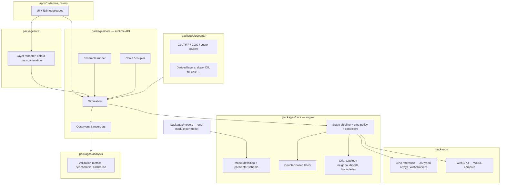

# CA engine architecture

**Status:** accepted baseline 2026-10-13; **revision 1.1, 2026-10-14** — refinements from the
14 model cards (`docs/review/shared-components.md`, "Implications" I1–I16; ADR 0007).
Key decisions: ADRs `docs/decisions/0002`–`0006` (execution model, backends, RNG,
TypeScript, MIT licence); revision 1.1 is proposed as ADR 0007 (primitive set revision). Requirements: `requirements.md` (IDs `R…` below).
Coverage check per model: `model-mapping.md`.

Interface sketches are TypeScript, the implementation language (ADR 0005); they are
sketches, not final signatures.

## 1. Purpose and scope

One engine that runs all selected ca-geo models (6 core, 8 extension) in the browser and
headless in Node, with:

- one **declarative model definition** per model (layers, parameters, stages, time policy),
- a small set of **stage primitives** that together cover every update scheme found in the
  template models (gather, flux, queue, particles, allocation, …),
- a **CPU reference backend** (the specification) and a **WebGPU backend** for the heavy
  stencil / flux models,
- reproducible randomness, ensembles, model chaining, validation against published
  benchmarks.

Out of scope of the engine: map rendering and UI (package `viz`, apps), data download
(package `geodata` prepares inputs, the engine only receives layers).

## 2. Design principles

1. **Models are data + small kernels, the engine owns the loop.** A model declares what it
   needs; scheduling, buffering, boundaries, RNG, reductions and observers are engine
   services. This keeps models short and comparable with their papers.
2. **Gather, never scatter, in parallel stages.** Each parallel stage writes only its own
   cell (or own face). Scatter-like processes (outflow distribution, emigration) are
   expressed as two gather passes (outflow slots → inflow gather). This makes CPU and GPU
   execution order-independent and conservation exact by construction (R3.2).
3. **Sequential processes are first-class, not hacks.** Priority-queue fronts, active
   lists with parents and agent conflict resolution are separate primitives that run on
   the CPU backend (R3.4–R3.6). They are not forced into a synchronous stencil.
4. **CPU reference first.** Every kernel exists as a plain JS reference; GPU kernels are
   optimisations that must pass equivalence tests (R11.3).
5. **Reproducible by construction.** Random numbers come from a counter-based generator
   keyed by position in the computation, not from a sequential stream (R5.1, R11.8).
6. **Traceable parameters.** Every default value carries its provenance (BibTeX key +
   table / section) or is marked as an assumption (R10.1; project rule against invented
   values).
7. **No user-facing strings in the engine.** Layers, states, parameters and messages have
   i18n keys only (R11.6).

## 3. Overview



## 4. Packages (npm workspaces)

| Package | Responsibility | Depends on |
|---|---|---|
| `@ca-geo/core` | Grid, topology, layers, neighbourhoods, model definition API, stage pipeline, time policies, controllers, RNG, reductions, boundaries; CPU backend; runtime API (Simulation, Ensemble, Chain); worker protocol | — (no runtime deps) |
| `@ca-geo/backend-webgpu` | WGSL code generation for stages, buffer management, GPU reductions, equivalence-test hooks | core |
| `@ca-geo/geodata` | Raster / vector loading (GeoTIFF / COG), reprojection, resampling, rasterisation, derived terrain and cost layers, caching | core (types) + chosen libraries (open question) |
| `@ca-geo/models` | Model definitions: layers, parameters with provenance, stages with CPU (+ optional WGSL) kernels, scenarios, i18n keys | core |
| `@ca-geo/analysis` | Ensemble aggregation, validation metrics, benchmark runner, calibration helpers | core |
| `@ca-geo/viz` | Rendering of layers (colour maps, hillshade, animation), map integration | core |
| `@ca-geo/i18n` | Shared `cs` / `en` catalogues and lookup helpers | — |
| `apps/*` | Demos (one per model or scenario chain) | all |

## 5. Core concepts

### 5.1 Grid and topology (R1.1, R1.6, R1.7)

```ts
interface GridSpec {
  rows: number; cols: number;
  cellSize: number;               // metres
  origin: [x: number, y: number]; // upper-left corner in CRS units
  crs: string;                    // e.g. "EPSG:3035" (to be decided per demo)
  topology: 'square' | 'hex' | 'graph';
  mask?: LayerRef;                // domain mask (0 = outside / NoData)
}
```

- **square** — the default and the only topology required by core models.
- **hex** — offset-coordinate hex grid; neighbourhood offsets depend on row parity. Planned
  (C priority); models can resample to square instead.
- **graph** — cells are polygons; adjacency in CSR form (`offsets`, `neighbours`,
  optional per-edge attributes). Only gather / flux / queue stages are defined on graphs.

All topologies expose the same **slot model**: cell `i` has `K` neighbour slots
(4 / 6 / 8 / variable), each with target index, distance, unit direction vector and an
optional per-edge attribute. Kernels address neighbours by slot, never by raw offsets, so
the same kernel works on square and hex grids.

### 5.2 Layers (R1.2–R1.5)

```ts
type DType = 'u8' | 'u16' | 'i32' | 'f32';
type Placement = 'cell' | 'face' | 'slot';     // cell-centred, edge-centred, per neighbour
type Role = 'input' | 'state' | 'derived' | 'output' | 'scratch';

interface LayerDecl {
  id: string;                 // e.g. "water.depth"
  dtype: DType;
  placement: Placement;       // 'face' = 2 arrays (x-faces, y-faces); 'slot' = K values per cell
  role: Role;
  unit?: string;              // SI unit, e.g. "m", "m3 s-1"
  categories?: CategoryTable; // for categorical layers: class → parameters (R1.3)
  i18nKey: string;            // label in cs/en catalogues
  boundary?: BoundaryPolicy;  // §9
  doubleBuffered?: boolean;   // engine sets true for states written by gather stages
}
```

- **Categorical layers + lookup tables** (fuel → spread probability; land use → cold-air
  production and resistance; class → Manning n) are uploaded once; kernels read
  `lut(table, class, field)`.
- **Face layers** implement staggered (Arakawa-C-like) grids for local-inertial water flow
  and momentum-based cold air (R1.4).
- **Slot layers** hold one value per neighbour: outflows of the weighted / MoD flow rules,
  barrier permeability (river between two cells), per-slot slope (R1.5). Kernels can read a
  neighbour's value for the opposite slot via `reverseSlot(k)` ("what does my neighbour send
  towards me"). An extended 16-slot neighbourhood (knight's moves) is available for `queue`.
- **Slot masks** (u8 bitmask per cell) store sets of slots — parents of a lava cell, donors
  of a runout cell (SC-SLOTMASK).
- **Persistent intermediate layers:** a `flux` outflow / face layer can be declared as state
  (kept between steps, readable by submodels — WCA2D previous outflows, local-inertial
  discharge, erosion reading water fluxes) instead of scratch.
- **Lookup tables are live:** a controller may recompute a table from mutable parameters
  (SLEUTH slope table after self-modification) and an intervention may swap a table
  (management scenario of the beetle model); the engine re-uploads it to the GPU (I12).
  Two-key tables (class × class, distance ring × class × class) are supported (SC-PAIRLUT).

### 5.3 Neighbourhoods and kernels (R2)

```ts
interface Neighbourhood {
  kind: 'vonNeumann' | 'moore' | 'moore16' | 'radius' | 'custom';
  radius?: number | ParamRef;            // may depend on forcing (wind-dependent radius)
  weights?: WeightTable                  // static weights, optionally per (ring, srcClass, dstClass)
          | ((dx: number, dy: number, dist: number) => number);
  normalise?: boolean;                   // weighted average Σw·x / Σw over valid neighbours
  centreWeight?: number | ParamRef;
  direction?: { field: 'wind' | 'aspect' | LayerRef };  // per-slot direction values (R2.3)
}
// Per slot the kernel receives: target index, distance, unit vector, reverseSlot(k);
// with `direction`: cos of the angle to the field, field magnitude; with a DEM: ΔE to the
// target (SC-DIRSLOPE). The kernel decides how to combine them (multiplier, exponent, …).
```

- Small neighbourhoods are unrolled into slot tables.
- The engine **does not combine direction factors** itself: fire rules multiply them, other
  rules use them as exponents (I8). It only provides the per-slot values.
- Extended kernels (radius ≤ ~7, i.e. up to 15 × 15) run as a **stencil stage** with a
  weight table; direction-dependent weights are recomputed only when the driving vector
  changes (global wind) or read per cell (raster wind).
- Large kernels (hundreds of cells across) use a **convolution stage** (FFT on CPU, tiled
  or separable approximation on GPU) (R2.4).
- Long-distance jumps are a separate **jump stage** (§6), not a huge neighbourhood (R2.5).

### 5.4 Parameters (R10.1, R10.3)

```ts
interface ParamDecl {
  id: string; unit?: string;
  default: number | number[] | string;
  range?: [number, number];
  provenance: { ref: string /* BibTeX key */, where: string /* "Table 2" */ }
            | { assumption: string };      // explicit, reviewed assumption
  i18nKey: string;
  scope: 'global' | 'perClass' | 'raster'; // scalar, LUT column, or layer
  mutable?: boolean;                      // may change during the run (controllers, UI)
}
```

Scenario presets bundle inputs, parameter overrides, seed and time span; they serialise to
JSON and can be shared as files or URLs (without personal data).

### 5.5 Model definition

```ts
interface ModelDef {
  id: string;                        // e.g. "HAZ-01/alexandridis"
  version: string;
  references: string[];              // BibTeX keys of templates
  topology: GridSpec['topology'][];  // supported topologies
  layers: LayerDecl[];
  params: ParamDecl[];
  time: TimePolicy;                  // §7
  stages: StageDecl[];               // executed in order every step (§6)
  init?: StageDecl[];                // run once before the first step
  controllers?: Controller[];        // host logic between steps (§7.3)
  observers?: ObserverDecl[];        // default outputs (§11)
  interventions?: InterventionDecl[];// what the UI may change (R6.3)
}
```

A model can contain **submodels** (named groups of layers and stages) so that tightly
coupled processes run in one simulation and share layers each step (erosion reading water
fluxes, R9.2).

## 6. Execution model — stage primitives

Each step executes the model's stage list in order. Every stage declares the layers it
**reads** and **writes**; the engine derives buffering, synchronisation and GPU bindings
from these declarations and rejects definitions that read and write the same layer in a
parallel stage without double buffering.

| Primitive | Semantics | Backend | Requirements | Typical users |
|---|---|---|---|---|
| `map` | Cell-local update: `out[i] = f(in[i], params, rng(i))`. | CPU, GPU | R3.1, R6.1 | growth (Ricker, Gompertz), sources / sinks, decay, reclassification |
| `stencil` | Synchronous gather from a neighbourhood (slots or weighted kernel) into the cell's own new value. | CPU, GPU | R3.1, R2.1–R2.3 | fire ignition, beetle infestation, SLEUTH edge growth, floor-field diffusion, focal dispersion |
| `flux` | Two passes: (a) **outflow pass** — either a *donor kernel* (cell writes bounded outflows to its slots / faces) or a *face kernel* (one antisymmetric value per face from both sides); optional **per-donor limiter** sub-pass (scale outflows so Σ out ≤ available); optional **retention** threshold (mobile part = max(0, h − h_ret)); (b) **gather pass** updates the cell. Declared flux unit (volume per step, rate, unit discharge). Integer / multinomial mode and an ordered slot loop with RNG for stochastic integer exchange. The flux layer may be persistent state. | CPU, GPU | R3.2, R1.4, R1.5 | WCA2D / MoD water, local-inertial water, cold air, groundwater, emigration, sediment, SCIDDICA, dynamic floor field |
| `reduce` | Global reduction (sum, min, max, count, histogram, arg-max) of an expression over cells; result available to controllers and time policy. | CPU, GPU | R4.2, R8.1, R6.4 | adaptive Δt, mass balance, growth rate, convergence test |
| `convolve` | Convolution with a large static kernel (FFT / separable / tiled). | CPU, GPU | R2.4 | short-range dispersal kernels (Xylella), propagule pressure |
| `jump` | Sparse stochastic long-distance events with pluggable **emission** (count per source), **distance** and **direction** laws and **acceptance** (probability layer, not only a mask); masked targets are discarded or redrawn; **conservative mode** debits the source; deterministic multi-cell **rays** (wind-aligned ignition). CPU: event list; GPU: per-source draws + atomic accumulation. | CPU, GPU* | R2.5 | long-distance dispersal, fire spotting, group migration |
| `queue` | Priority-queue propagation (Dijkstra / ordered sweeps): multi-source; relax function may read any layer; direction flag (time **to** or **from** sources, matters for anisotropic cost); outputs value, `parent` and `nearest` source; 8 or 16 slots; stochastic (e.g. exponential) edge times; may be **re-run during a simulation** (controller / intervention, e.g. a new exit). | CPU | R3.4, R7.2 | accessibility front, static floor field, rabies first-passage front, PROPAGATOR-style time-to-ignition, priority-flood, ordered FlowFill |
| `front` | Active-list propagation in two modes: **shared-grid relaxation** (one grid; cells re-enter the list; per pulse iterate until no excess; deterministic or keyed-shuffle order) and **per-source traversal** (each source has sparse per-path state — flux, energy line, parent set — merged by max / sum / count into global outputs; sources independent → parallel workers). Eligibility, flow weights, persistence and cutoff come from the shared flow-weight library. | CPU | R3.5, R4.4 | lava (Connor / MOLASSES), Flow-Py runout, rockfall, avalanche |
| `agents` | Lattice agents with exclusion: **propose** (each agent picks a target from a probability over slots; per-agent move probability for speeds below one cell per step), **resolve** (conflicts: random winner or friction μ; conflict counts reported), **move**, update occupancy layer; sinks remove agents. | CPU (GPU later) | R1.8, R3.6 | pedestrian floor-field CA |
| `allocate` | Demand-constrained allocation. Modes: **top-N** per class; **joint greedy multi-class** (globally highest (cell, class) potential among classes with unmet demand, each cell once); **zone quotas**; **weighted sampling without replacement** (random keys u^(1/w) + top-N); **patch growth** (seed + contiguous growth to a drawn size, uses `queue`); optional **allowed-transition matrix**. Ties by keyed RNG. | CPU, GPU* | R3.7 | constrained land-use CA (SIMLANDER, PLUS, FUTURES) |
| `events` | Sequential sparse **event scripts** (replaces `walk`, ADR 0007): K events (count from parameters), each picks a start (uniform over a mask or from a list, e.g. this step's new cells), optionally searches (spiral / nearest feature), optionally walks along a feature layer (directed or undirected, step limit from a layer value), then performs a local action with up to n neighbour tries. Keyed RNG per event id. | CPU | R2.6 | SLEUTH spontaneous growth, spreading centres and road growth; corridor moves of invasive species |
| `custom` | Escape hatch: arbitrary JS over whole arrays (CPU only), declared reads / writes. | CPU | — | prototypes; must be replaced by primitives before GPU use |

\* GPU versions are optional optimisations; the CPU version is the reference.

**Scatter as gather.** Where a source picks one target (SLEUTH edge growth, short-range
spotting, agent proposals), the target can recompute each neighbour's keyed draw
`rng(source, tag)` and decide exactly as a scatter would — parallel stages stay gather-only.

**One-pass state updates.** When several transitions must read the same previous state
(a burning cell burns out while it ignites its neighbours), they belong to one `stencil`
stage, or all their outputs are double-buffered across the stages (I15).

**Repeat blocks.** A group of stages can be repeated inside one step a fixed number of
times (from a parameter or forcing) or until a condition (`reduce` result, demand met),
with a controller hook between iterations (SC-REPEAT: dispersion iterations per hour,
PLUS allocation until demand is met).

**Mixed pipelines.** A step may combine GPU stages and CPU stages (e.g. GPU flux water +
CPU queue); the engine inserts the needed buffer transfers. Because transfers are costly,
models that run thousands of steps should keep their per-step stages on one backend
(checked and reported by the engine).

**Active regions (R3.9).** Stages may declare an *activity predicate* (e.g. `depth > ε`
or `state == burning` within distance 1). The CPU backend maintains a list of active
tiles (e.g. 32 × 32); the GPU backend dispatches only active tiles from an indirect
dispatch list. Correctness never depends on activity (inactive tiles are no-ops).

## 7. Time and control

### 7.1 Time policies (R4.1–R4.4)

```ts
type TimePolicy =
  | { kind: 'fixed', dt: number, unit: 's' | 'min' | 'h' | 'day' | 'year' }
  | { kind: 'adaptive', dtFrom: ReduceRef, dtMin: number, dtMax: number, safety: number,
      every?: number,                              // recompute period (model time)
      snap?: 'fractionOfMax' | 'outputs',          // Δt = dtMax / k, or cut to hit output times
      lookAhead?: ForcingRef[],                    // include upcoming forcing in the limit
      growWhenIdle?: number,                       // e.g. ×2 if nothing moves
      retry?: { check: ReduceRef, maxTries: number } } // reject step, retry with smaller Δt
  | { kind: 'converge', on: ReduceRef, epsilon: number, patience: number }
  | { kind: 'budget', budget: ParamRef }          // e.g. lava volume
  | { kind: 'event' }                             // time advanced by the queue stage
  | { kind: 'oneShot' };                          // no model time (runout traversal);
                                                  // display clock = traversal generation
```

- Adaptive Δt is computed from a `reduce` stage at the start of the step (e.g. minimum of
  the CFL / velocity limits), clamped and multiplied by a safety factor; parameter values
  come from the template model, not from the engine. Δt may be **snapped** so that
  output times are hit exactly (as in caflood, `docs/research/implementations.md`); if
  nothing moves, Δt may grow up to `dtMax` (as in the SAGA cold-air tool).
- The **display clock** is separate: the runtime maps model time to animation frames
  (e.g. "1 s of animation = 10 min of model time") and skips or interpolates frames (R4.6).

### 7.2 Forcing (R4.5)

`Forcing` objects provide time-dependent values: scalar series (rain intensity, wind
vector, hourly meteorology) with interpolation rules, and raster series (radar rain) with
lazy loading and linear interpolation between slices (e.g. carrying capacity from
millennial layers); the domain mask itself may be a forcing (sea level). A forcing may
**reset** a layer at the start of each period (dispersion restarts from emissions every
hour). Stages read forcings as uniforms (`forcing('rain', t)`) or bound layers.

### 7.3 Controllers (R6.4)

Controllers are small host-side functions executed between steps with access to reduction
results, the clock and mutable parameters:

- **self-modification** (SLEUTH: growth rate above / below thresholds → multiply
  coefficients),
- **scheduled events** (hydrograph changes, lava pulses, ignition at time t),
- **stop conditions** (front extinguished, budget used, convergence, max time),
- **table rebuilds** (recompute a LUT from mutable parameters),
- **clustered random events** (cluster point process masks, e.g. catastrophes),
- **scenario triggers** (breach when a downstream crest is overtopped for a given time).

Controllers never touch cell arrays directly; they change parameters or enqueue
interventions, which keeps them backend-independent.

### 7.4 Interventions (R6.3)

User edits are queued as **interventions** (set cells in a mask to a value, paint a layer,
change a parameter, add / remove agents) and applied atomically at the next step boundary.
Each model declares which interventions it accepts (e.g. `ignite`, `firebreak`, `dam`,
`controlZone`, `exit`). Interventions are recorded so that a run can be replayed exactly.

## 8. Randomness (R5)

- **Counter-based generator**: `u32 = hash(seed, run, step, stage, cell, draw)`; floats
  derived from the top 24 bits. The same tuple gives the same number on CPU and GPU and
  regardless of evaluation order. Candidate functions: a Philox-style 32-bit block cipher
  or a well-tested 32-bit integer hash (choice in ADR 0004 after testing statistical
  quality and WGSL cost).
- **Distributions** (R5.2) implemented once for CPU and once in WGSL from uniform draws:
  Bernoulli, exponential, normal (Box–Muller), truncated normal (rejection with bounded
  attempts), Weibull (inverse CDF), Poisson / binomial (exact for small means, normal
  approximation above a documented threshold), **beta**, **lognormal** (incl. truncated),
  **categorical** (cumulative table), **multinomial** (sequential binomials), **discrete 2D
  Gaussian displacement**; sampling of cells from a probability raster (CDF / alias table,
  SC-SRCSAMPLE).
- **Ensembles**: run seeds are derived from a master seed and the run index; any single
  run of an ensemble can be replayed alone. Mutable parameters are **reset** to their
  initial values at the start of every run.
- **Statistical oracles:** reference implementations with their own sequential RNGs
  (SLEUTH, PyTorchFire, Xylella model) cannot be reproduced run by run; benchmarks compare
  distributions of statistics.
- **Sequential primitives** (`queue`, `front`, `agents`, `events`) draw with the same keyed
  generator using (agent id / event id, draw) so results do not depend on container order.

## 9. Boundaries and masks (R6.2)

Per layer (and per stage if needed):

| Policy | Meaning | Mass accounting |
|---|---|---|
| `open` | Neighbour outside the domain behaves as an infinite sink / zero value; outflows leave the domain. | Outflow recorded in a boundary-flux reduction. |
| `closed` | Neighbour outside does not exist (no exchange). | — |
| `fixed(value or layer)` | Dirichlet value outside / in marked cells (e.g. fixed head). | Exchange recorded. |
| `flux(value or layer)` | Prescribed inflow / outflow across the edge (Neumann). | Recorded. |
| `mirror` | Reflective copy of the edge cell. | — |
| `exitFlag` | Mobile material reaching the edge is recorded (and optionally stops the run). | Recorded. |

`fixed` and `flux` also apply to **interior cell masks** (fixed-head rivers in groundwater,
fixed-level reservoirs, emission cells reset every iteration). Stages may require sources
to be interior cells (SLEUTH never grows from the outer ring).

The domain mask defines inside / outside cells; additional **target masks** forbid
transitions into some cells (sea for dispersal jumps, buildings for pedestrians,
non-burnable classes). Boundary handling is generated by the engine (CPU: padded index
tables; GPU: generated WGSL branches), never written in model kernels.

## 10. Backends

### 10.1 CPU reference backend

- Layers are typed arrays (`Float32Array`, `Uint8Array`, …), row-major; face layers as two
  arrays; slot layers as `K × N` arrays (structure of arrays).
- Kernels are written at **range level** (a function receives the arrays and a range of
  rows) to avoid per-cell call overhead; the engine provides precomputed slot tables.
- The simulation runs in a **Web Worker** (browser) or a worker thread (Node). Ensembles
  use a pool of workers. Large inputs are transferred once; frames for the view are sent
  as transferable copies of the displayed layer, or via `SharedArrayBuffer` when the page
  is cross-origin isolated (depends on hosting — open question).

### 10.2 WebGPU backend

- Each `map` / `stencil` / `flux` / `reduce` / `convolve` stage compiles to one or more
  **WGSL compute shaders**. The engine generates the boilerplate (bindings, index
  computation, slot tables, boundary branches, RNG and distribution functions, LUT access);
  the model supplies only the **kernel body** in WGSL alongside the JS reference body.
- Double buffering by ping-pong bindings; reductions as two-level workgroup reductions;
  adaptive Δt read back asynchronously (one step of latency is allowed only where the
  model tolerates it — otherwise a GPU-side Δt clamp is used).
- Precision: `f32`. Mass balances are summed in two-level reductions and cross-checked on
  the CPU in tests.
- Rendering can sample state buffers directly (no read-back) when `viz` uses WebGPU.
- If WebGPU is unavailable, models fall back to the CPU backend (smaller grid presets).

### 10.3 Kernel authoring and equivalence

Every GPU-capable stage has two bodies: JS (reference) and WGSL. An equivalence test runs
both on fixed inputs and seeds and compares outputs with a per-layer tolerance (exact for
integer / categorical states, relative / absolute epsilon for floats). A shared kernel DSL
compiling to both is deliberately postponed (ADR 0003).

## 11. Runtime API

```ts
const sim = await Simulation.create({
  model: wildfireAlexandridis,          // ModelDef
  grid, inputs: { dem, fuel, density }, // layers from geodata
  params: { windSpeed: 6 },             // overrides (validated against the schema)
  seed: 42, backend: 'auto',            // 'cpu' | 'webgpu' | 'auto'
});
sim.intervene({ kind: 'ignite', cells: mask });
await sim.run({ until: { time: 3600 }, onFrame: draw, frameEvery: { modelTime: 60 } });
const arrival = await sim.read('fire.arrivalTime');      // output layer
const stats = sim.stats();                                // reductions per step

const ens = await Ensemble.run({ ...sameConfig, runs: 100, workers: 4,
  aggregate: ['frequency:fire.burnt', 'quantiles:fire.arrivalTime'] });

const chain = Chain.of(fireRun).then(burntToRunoffCoefficient).then(floodRun); // R9.1
```

- **Observers** (R8.1–R8.3): `reduce` series (also grouped by a zone layer), first-arrival
  time with a threshold predicate (and per-agent origin variant), max envelope, visit
  counts, values at station points, front speed (arrival vs. distance), back-tracking of
  paths from parent links, mass balance (optional per model), snapshots, exporters
  (GeoTIFF, PNG, CSV, JSON).
- **Ensembles**: frequency / probability maps, mean and per-cell quantiles of continuous
  fields (e.g. arrival time), per-step scalar statistics (mean / std), and **paired
  scenarios** with shared seeds for differences (relative risk).
- **Chains** (R9.1): sequential handover of layers between runs, with resampling when grids
  differ. Concurrent coupling with different clocks (R9.3) is a later extension using
  synchronisation points.
- **Replay**: a run is fully described by model version, inputs (hashes), parameters,
  seed, backend and intervention log.

## 12. Geodata pipeline (R7)

Runs before the simulation (in a worker or in Node), produces a `GridSpec` and input layers:

1. Load rasters (GeoTIFF / Cloud-Optimised GeoTIFF) and vectors (GeoJSON) for an area of
   interest; reproject and resample to the common grid.
2. Rasterise vectors: roads, rivers, polygons; **edge rasterisation** of line barriers into
   slot layers (which neighbour pairs a river separates).
3. Derive terrain layers: slope, aspect, hillshade, D8 direction, flow accumulation,
   depression filling (priority-flood), per-slot elevation difference, Euclidean distance
   transform and cost-distance (reusing the `queue` primitive).
4. Reclassify categorical layers via lookup tables (land cover → fuel, production, K).
5. Cache results (IndexedDB / OPFS in the browser, files in Node) keyed by input hashes.

Derived layers that depend on dynamic state (slope of an eroding DEM, effective elevation
under lava) are declared as **derived layers with dependencies** and recomputed by an
engine stage when their source changed (R7.5). Interventions that edit the DEM (dike,
breach, erosion) invalidate dependent layers (slope, D8, effective surface) automatically.

## 13. Analysis, validation, calibration (R8.4, R8.5, R10.2)

- Metrics: quantity / allocation disagreement, figure of merit, fuzzy kappa, Jaccard /
  Sørensen, F1, AUC, Boyce index, RMSE / NRMSE against series, arrival-time bias;
  connected components and landscape metrics; neutral benchmark models as baselines — each implemented with tests against the
  published reference implementations where available (`pontius2011death`,
  `hagenzanker2009improved`).
- **Benchmark runner**: a benchmark = model + inputs + parameters + expected outputs +
  metric + tolerance; runs headless in Node (CI) and in the browser (demo "how good is
  our model?").
- Calibration helpers: parameter sweeps, random / Latin-hypercube sampling, simple
  optimisers, running ensembles in workers; heavy calibrations offline in Node.

## 14. Internationalisation and provenance

- Engine and models expose only keys (`layer.water.depth`, `param.fire.ph`,
  `state.fire.burning`, `error.param.outOfRange`); apps resolve them with the `cs` / `en`
  catalogues. A test fails if a model key is missing in either catalogue (same keys in
  both, R11.6).
- Each model module contains a short "model card" pointer (`docs/models/...`) and the
  provenance of every default; the UI can show "source: <reference>, Table 2".

## 15. Testing strategy

| Level | What | Where |
|---|---|---|
| Unit | Primitives (slot tables, boundaries, RNG distributions, reductions, queue) | core, Node |
| Property | Mass conservation of `flux` stages, determinism (same seed → same output), order independence | core |
| Equivalence | CPU vs WebGPU per stage and per model, with tolerances | backend-webgpu (headless browser) |
| Model | Each model against its template's published results (fire shapes, SLEUTH demo outputs, Flow-Py tests, Theis solution, EA flood benchmarks, lava benchmarks, FFCA evacuation curves) | analysis benchmark runner |
| i18n | Key parity of `cs` / `en` catalogues | i18n |

## 16. Lessons from reference implementations

From `docs/research/implementations.md` (source code read, paraphrased):

| Implementation | Observation | Consequence for the engine |
|---|---|---|
| caflood (WCA2D) | Two-phase edge outflow → cell update; adaptive Δt from max velocity, snapped to output times | Confirms `flux` primitive and adaptive / snapped time policy |
| PROPAGATOR | Event-driven min-heap per realisation; external events (wind change, firelines) cut the run into windows | Confirms `queue` + controllers that split runs into windows; ensemble dimension inside one run is an optimisation to consider |
| Cell2Fire | Fixed fire period with per-neighbour progress accumulators | Third fire variant expressible as `stencil` + slot layer (progress per neighbour) |
| SAGA Cold Air Flow | Moore multiple-flow-direction outflow, CFL-like adaptive Δt, open / closed edges | ATM-02 shares the WAT outflow machinery; adaptive Δt also for ATM-02 |
| MOLASSES | Active list + parent code, pulses, explicit volume check | Confirms `front` primitive and mass observers |
| Flow-Py | Path-wise traversal per release cell, tile-level multiprocessing | `front` must support per-release-cell independence (parallel workers) |
| dispeRse | Frontier list updated in place → order-dependent results | Our gather-only rule avoids this; arrival-time output is a useful default observer |
| GRASS `r.sim.water` | Counter-based random stream per walker, independent of thread count | Supports ADR 0004 |
| PoPS | Pluggable dispersal kernels; separate seeded generator per process | Kernel library for `convolve` / `jump`; RNG key includes stage id (≈ per-process stream) |
| WebFlood | WebGL ping-pong textures, GPU reduction for water-volume check, in-browser GeoTIFF loading | Browser feasibility precedent for the GPU backend and geodata loading |
| SLEUTH | Own seeded RNG, yearly Monte Carlo, expected outputs in the distribution | Benchmark oracle for LND-01 |

No validated geographic CA of any selected model exists in JavaScript; the engine is
new in this respect, but every primitive has a working reference in another language.

## 17. Risks and open questions

| # | Topic | Question / risk | Proposed handling |
|---|---|---|---|
| Q1 | WebGPU availability | Coverage of target browsers / school computers. | CPU fallback is mandatory; verify browser support at the start of implementation (to be verified). |
| Q2 | Kernel duplication | Two bodies (JS + WGSL) per GPU stage cost effort and may diverge. | Equivalence tests; GPU only where needed; revisit DSL after 3–4 models. |
| Q3 | Float determinism | CPU f32 emulation vs GPU f32 can differ (fused operations, transcendentals). | Determinism guaranteed per backend; cross-backend within tolerance. |
| Q4 | Cross-origin isolation | `SharedArrayBuffer` needs COOP/COEP headers; static hosting may not allow it. | Design works with transferable copies; shared memory is an optimisation. |
| Q5 | Language | — | **Resolved:** TypeScript (ADR 0005). |
| Q6 | Licence of ca-geo | — | **Resolved:** MIT with clean-room rule; copyleft code only as reference / oracle (ADR 0006). |
| Q7 | Geodata libraries | GeoTIFF / reprojection / rasterisation libraries and their size. | Evaluate in the geodata phase. |
| Q8 | Hex and graph topologies | Effort vs value. | Keep the slot abstraction; implement square first; hex / graph only if a selected model needs them. |
| Q9 | Event-driven fire (PROPAGATOR) vs synchronous fire (Alexandridis) | Two engines for one phenomenon? | Both are expressible (`queue` vs `stencil`); start with the synchronous variant. |
| Q10 | Very long runs (land use over decades with Monte Carlo) | Performance of `allocate` / `events` on the CPU. | Profile with SLEUTH demo data; move to GPU only if needed. |
